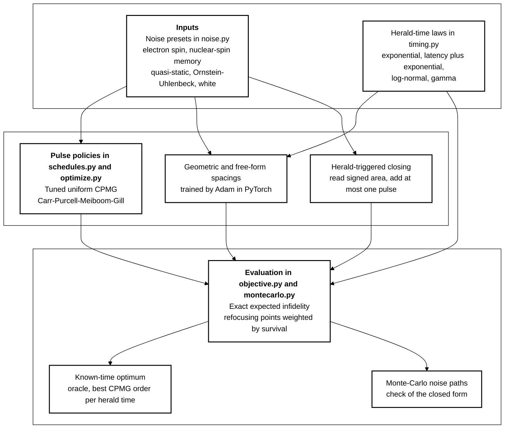
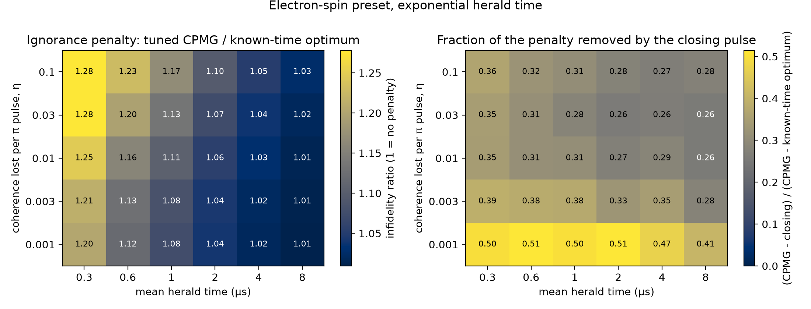
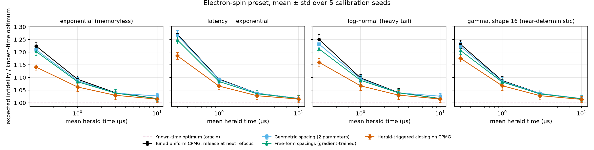
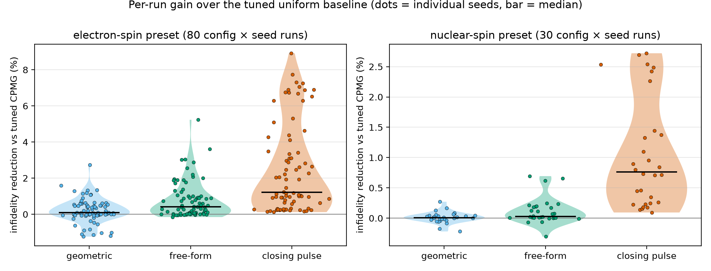
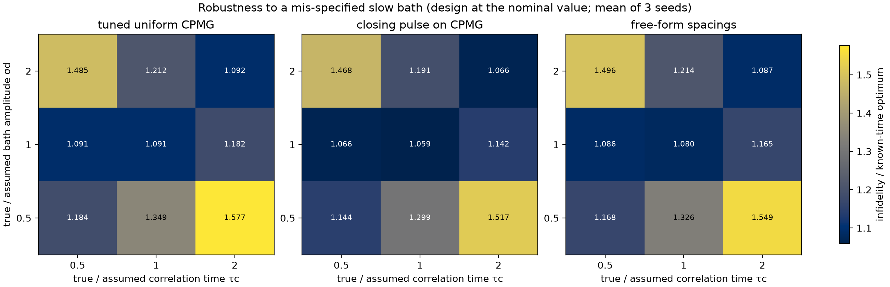

# Herald-Aware Dynamical Decoupling Schedules for a Spin Quantum Memory

[](LICENSE)
[](pyproject.toml)
[](.github/workflows/ci.yml)

**Abstract.** A spin memory in a quantum network is released when a random heralding signal arrives, so a
dynamical decoupling sequence cannot be timed to end with a refocusing echo. We quantify, with an exact Gaussian
dephasing model of a nuclear-spin bath (validated against explicit noise trajectories), the fidelity lost by this
ignorance of the release time, and test a herald-triggered closing pulse and gradient-trained pulse schedules against a tuned
Carr-Purcell-Meiboom-Gill (CPMG) baseline and a known-time optimum. The ignorance penalty is small (1.2 % to 27 %) and only exceeds 10 % when the mean
herald time is about two echo periods; the closing pulse recovers a median 26 % of it, while offline-learned schedules do not help. All results are classical-noise simulations.

## Motivation

Semiconductor spin qubits, including electron and nuclear spins in gallium arsenide (GaAs) quantum dots, combine long
coherence with coherent control (Burkard et al., 2023, doi:10.1103/RevModPhys.95.025003). In a quantum repeater or
teleportation link the memory holds its state until a classical herald confirms success
(Azuma et al., 2023, doi:10.1103/RevModPhys.95.045006; Hu et al., 2023, doi:10.1038/s42254-023-00588-x).
Dynamical decoupling normally assumes a storage duration known in advance, whereas a repeat-until-success link fixes it at random.

## Research gap

Within the supplied literature, network-side papers treat the memory as "wait for the herald" and spin-side papers treat
decoupling as "protect for a known duration" (full related-work table of 11 papers: [`docs/RESEARCH_GAP.md`](docs/RESEARCH_GAP.md)).
Software-level work exploits hardware asymmetries in a fixed circuit (Du et al., 2027, doi:10.1016/j.future.2026.108830)
or reduces communication cost (Cardama et al., 2027, doi:10.1016/j.future.2026.108815), but none designs idle-time
control for a random release time. The open question: how much fidelity does not knowing the release time cost, and how much can a control policy recover?

### What is new here

* Formulates dynamical decoupling of a networked spin memory as a *stopping-time* problem with exact expected infidelity (no sampling error in the comparison).
* Introduces a herald-triggered closing policy (read the signed phase area at the herald, add at most one pulse, release at the nearest refocusing point) and measures what it removes.
* Reports a negative result for offline-optimised free-form and geometric schedules under the same exact objective.
* Evaluates every design under calibration error: designs see a perturbed noise model, scoring uses the true one.

## Hypotheses

Metric: expected process infidelity at release, divided by the known-time optimum (an oracle that knows the herald time `T`).

| ID | Hypothesis (threshold fixed in `docs/RESEARCH_GAP.md`) | Outcome |
|---|---|---|
| H1 | Tuned CPMG loses at least 10 % relative to the known-time optimum when the mean herald time is a few echo periods; penalty shrinks with longer times | **Partly supported** |
| H2 | Closing pulse recovers at least 20 % of the penalty in at least 75 % of configurations | **Supported**, but absolute gains are small |
| H3 | Gradient-trained free-form schedule beats tuned CPMG by at least 5 % for non-memoryless herald laws | **Falsified** |
| H4 | The H2 advantage survives a factor-2 error in assumed bath amplitude and correlation time | **Supported** (sign), all policies degrade together |

## Method



The stored phase is the signed integral of a quasi-static Overhauser field, an Ornstein-Uhlenbeck (OU) component and a white floor;
each π pulse costs a coherence factor `1 - η`. The memory is released at the first *refocusing point* after the herald, a time where the
signed area of the switching function is zero, which cancels the quasi-static field exactly. The OU variance has a closed form, so the
expectation over the random herald time is exact for any schedule. Policies: free evolution (classical baseline), tuned uniform CPMG
(standard baseline), geometric and free-form learned spacings, the closing policy, and the known-time optimum. A seed is one calibration
realisation (log-normal error 0.2 on the design's bath amplitude, correlation time and pulse loss). Details: [`docs/METHOD.md`](docs/METHOD.md).

## Results

All numbers come from `results/` (110 policy-comparison runs = 22 configurations × 5 seeds; heatmap and mismatch sweeps; 72 validation points).
Total experiment compute: 826.7 s (`results/run_meta.json`).

**Validation.** Against explicit Monte-Carlo noise paths (regular and irregular schedules, electron and nuclear presets) the closed form
differs by at most 0.0020 in infidelity (mean 0.00031) ([`figures/fig5_montecarlo_validation.png`](figures/fig5_montecarlo_validation.png)).
Free evolution without control is almost fully dephased (infidelity 0.436 to 0.500 for the electron preset).

### H1: ignorance penalty



*Takeaway: not knowing the herald time costs up to 28 % at mean herald time 0.3 µs and under 3 % beyond 8 µs; the closing pulse removes a quarter to a half of it.*

Over 22 configurations the tuned CPMG ratio to the known-time optimum ranges from 1.012 to 1.270 (`results/summary.json`);
only 4 of 22 configurations (18 %), all at mean herald time 0.3 µs (about 2.1 echo periods), reach 10 %. At about 6.6 echo periods the ratio is 1.088 to 1.098.
The penalty correlates with the logarithm of the mean herald time in echo periods at r = -0.90.

### H2: herald-triggered closing



*Takeaway: the closing pulse (orange) lies below tuned CPMG (black) for every herald law; learned schedules (blue, green) track CPMG.*

| Electron preset, ratio to known-time optimum (mean ± std over 4 laws × 5 seeds) | 0.3 µs | 1 µs | 3 µs | 10 µs |
|---|---|---|---|---|
| Tuned uniform CPMG | 1.244 ± 0.024 | 1.093 ± 0.014 | 1.039 ± 0.014 | 1.017 ± 0.012 |
| Geometric spacing | 1.233 ± 0.026 | 1.090 ± 0.013 | 1.038 ± 0.013 | 1.022 ± 0.012 |
| Free-form spacings | 1.218 ± 0.023 | 1.085 ± 0.014 | 1.037 ± 0.013 | 1.017 ± 0.011 |
| Herald-triggered closing | **1.166 ± 0.021** | **1.066 ± 0.016** | **1.029 ± 0.015** | **1.014 ± 0.012** |

The nuclear-spin preset (mean herald time 100, 300, 1000 µs; exponential and latency laws) gives the same ordering, e.g. at 100 µs 1.092 ± 0.011 (CPMG)
versus 1.069 ± 0.016 (closing). The closing policy recovers a median 26 % of the penalty (range 19 % to 37 % per configuration), at least 20 % in 20 of 22
configurations (91 %), and beats tuned CPMG in 110 of 110 runs. In the heatmap sweep the recovered share is 26 % to 51 % (median 32 %), largest (about 50 %) at the lowest pulse loss, η = 0.001.
The absolute gain is modest: median 1.05 % and at most 8.9 % lower infidelity than tuned CPMG.



*Takeaway: the closing pulse gives a consistent positive gain in every seed, while geometric and free-form schedules scatter around zero.*

### H3: offline-learned schedules (negative result)

Free-form gradient-trained spacings improve on tuned CPMG by a median 0.17 % over all runs, at most 3.0 % in any non-memoryless configuration, and in none of the non-memoryless configurations reach the 5 % threshold;
geometric spacing improves by a median 0.04 %. Free-form is better than CPMG in 84 % of runs but by amounts within seed scatter. A tuned uniform sequence is already near-optimal for the cost structure studied.

### Ablation

Re-tuning the CPMG spacing for the closing policy gives a median 0.0 % change versus reusing the CPMG optimum, so the closing pulse is the active ingredient. The parametrisation ablation (uniform, 2-parameter geometric, free-form) is the H3 comparison above.

### H4: robustness to a mis-specified bath



*Takeaway: the closing pulse stays ahead of tuned CPMG in all 9 mismatch cells, but a factor-2 error costs every policy far more than the policy choice gains.*

Closing beats CPMG in 9 of 9 cells. At the nominal point the ratios are 1.091 (CPMG), 1.059 (closing) and 1.080 (free-form); in the worst cell (true amplitude 0.5×, correlation time 2×) they are 1.577, 1.517 and 1.549.

## Discussion

The cost of not knowing the herald time is real but small in this model, because refocusing points are dense (tuned spacing about 0.14 to 0.16 µs for the electron preset) relative to
typical herald times. It matters when the mean herald time is a few echo periods, i.e. fast links or slow, pulse-limited sequences. The closing policy is cheap, needs no extra hardware beyond a conditional pulse, and
helps in that regime, but its absolute gain (at most 8.9 %) is smaller than the penalty induced by a factor-2 bath calibration error (up to a ratio of 1.5). H1 was therefore only partly supported: the 10 % penalty
appears at about 2 echo periods and not at about 6.6. H3 failed: the exact objective is nearly flat around uniform spacing, so gradient training finds almost nothing. Memoryless herald laws are not special:
non-memoryless laws also give no learned-schedule gain, probably because the refocusing grid is fine compared with the spread of the herald time. The refocused-release policy makes the quasi-static field
(the largest noise term) irrelevant to all policies except free evolution, so the nuclear and electron presets differ only through the dimensionless set `σd·τc`, `γ0·τc`, `η` and `T/τc`.

## Limitations

* Classical Gaussian dephasing of a single qubit; no relaxation, non-Gaussian bath, or two-qubit effects.
* Pulses are instantaneous; finite duration and off-resonance errors are lumped into one number `η`, so the quasi-static field never enters pulse quality.
* Presets are illustrative orders of magnitude, not fits to a device. Preset grids and the hypothesis thresholds were set after pilot calculations of the same model, so no held-out check exists.
* The known-time optimum is restricted to CPMG sequences; the closing policy is only tested on a CPMG background.
* Seeds sample calibration error and optimiser jitter only; herald-time sampling noise is removed by exact expectations.
* No quantum advantage is involved or claimed; this is a simulation study.

## Future work

Fit `σd`, `τc` and `η` from noise spectroscopy of a GaAs quantum-dot electron spin and of its nuclear-spin register, then test the closing policy on hardware with a real classical-signal latency
(a field-programmable gate array can read the herald and issue the closing pulse). Extend the model to finite-width pulses with Overhauser-field-dependent errors, and to entanglement-distillation protocols in which several memories share one herald.

## Reproducibility

```bash
pip install -r requirements.txt && pip install -e .
pytest -q                           # 11 tests, about 30 s
python experiments/run_all.py --quick   # smoke run, about 35 s of compute, writes to a temporary directory
python experiments/run_all.py           # full study, 826.7 s on the reference machine
```

Reference machine: Windows 11, Python 3.11.9, torch 2.11.0, numpy 2.2.6, 16 CPU threads (6 used, float64 on the central processing unit; the GPU is not needed).
Raw outputs: `results/policy_comparison.csv`, `policy_summary.csv`, `penalty_heatmap.csv`, `robustness_mismatch.csv`, `montecarlo_validation.csv`, `freeform_schedules.json`, `summary.json`, `run_meta.json`.

## Related work by the author

* [`fusion-retry-window-delay-loss-budget`](https://github.com/pradeepdegalaroyal/fusion-retry-window-delay-loss-budget): how many repeat-until-success attempts a photonic fusion node should get when each retry costs delay-line loss.
* [`dual-rail-erasure-bias-swap-echo-vs-inversion`](https://github.com/pradeepdegalaroyal/dual-rail-erasure-bias-swap-echo-vs-inversion): swap-echo correction of a memory bias under shot noise and calibration drift.

## Project structure

```
src/herald_dd/   noise.py timing.py schedules.py objective.py optimize.py montecarlo.py
experiments/     run_all.py plots.py summarize.py
tests/           test_herald_dd.py
docs/            RESEARCH_GAP.md METHOD.md
results/ figures/  outputs of run_all.py
```

## Citation

```bibtex
@software{degala_herald_aware_dd_2026,
  author  = {Degala, Chenchupradeep},
  title   = {Herald-Aware Dynamical Decoupling Schedules for a Spin Quantum Memory},
  year    = {2026},
  version = {0.1.0},
  url     = {https://github.com/pradeepdegalaroyal/herald-aware-dynamical-decoupling-spin-memory},
  license = {MIT}
}
```

MIT license (`LICENSE`). Citation metadata: `CITATION.cff`.
